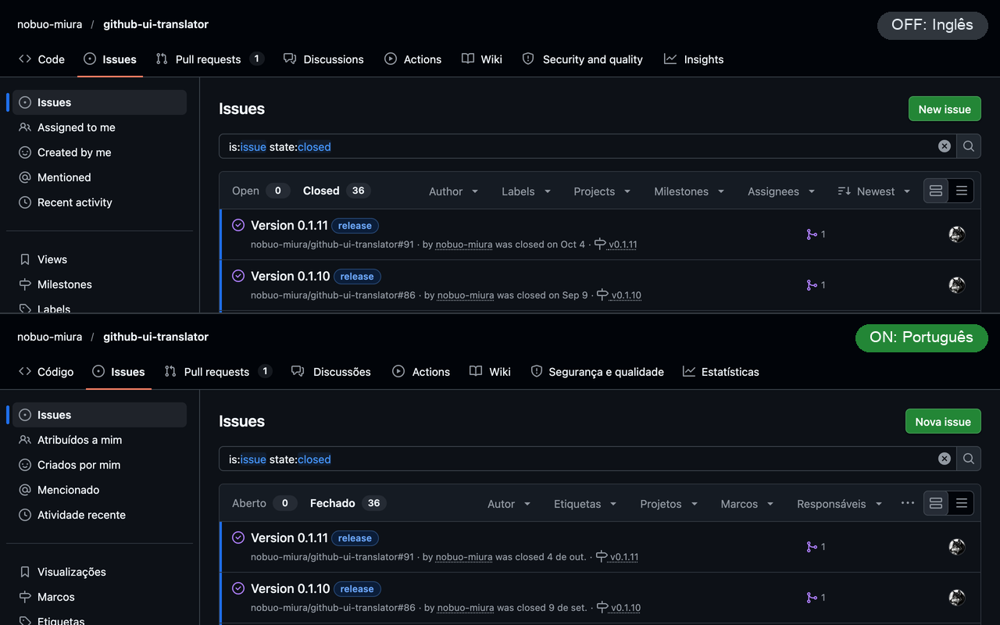
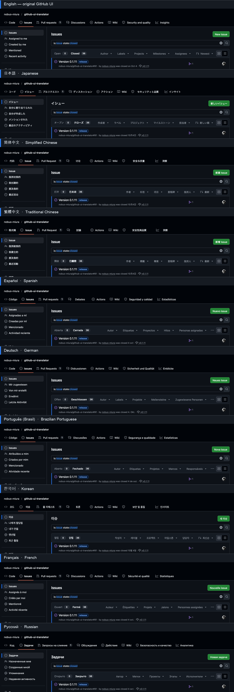
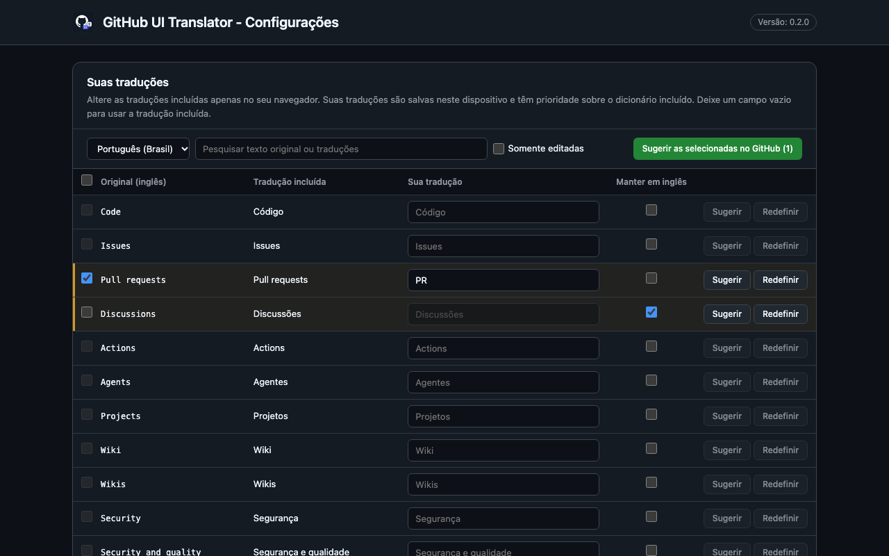

# GitHub UI Translator

[English](README.md) | [日本語](README.ja.md) | [简体中文](README.zh-CN.md) | [繁體中文](README.zh-TW.md) | [Español](README.es.md) | [Deutsch](README.de.md) | [Português (Brasil)](README.pt-BR.md) | [한국어](README.ko.md) | [Français](README.fr.md) | [Русский](README.ru.md)

[](https://github.com/nobuo-miura/github-ui-translator/releases/latest)
[](https://chromewebstore.google.com/detail/github-ui-translator/igdplojdbbpfbedgoaokfcagpkofmngk)
[](https://microsoftedge.microsoft.com/addons/detail/fgjocjmjjghflobobinafkbkeildanoj)
[](https://addons.mozilla.org/firefox/addon/github-ui-translator/)
[](https://github.com/nobuo-miura/github-ui-translator/actions/workflows/validate.yml)
[](./LICENSE)

GitHub UI Translator é uma extensão para Chrome, Edge e Firefox que traduz a interface em inglês do GitHub para japonês, chinês simplificado, chinês tradicional, espanhol, alemão, português do Brasil, coreano, francês ou russo usando dicionários locais.
Ela não depende de APIs externas de tradução nem de serviços em nuvem: toda a tradução é feita localmente no navegador.



<details>
<summary>Capturas de tela em 9 idiomas</summary>

A primeira linha mostra a interface original do GitHub em inglês; as linhas seguintes mostram o resultado da tradução em cada idioma.



</details>

## Recursos

- Faz toda a tradução localmente, sem enviar o conteúdo das páginas ou as configurações para serviços externos
- Traduz textos fixos da interface do GitHub, como itens de navegação e botões, evitando áreas de conteúdo criado por usuários, como READMEs, problemas, comentários e blocos de código
- Permite ativar ou desativar a tradução pela janela pop-up da extensão
- Traduz o cabeçalho global somente depois que a hidratação do React do GitHub termina, reduzindo o risco de interferir na pesquisa global; essa opção também pode ser desativada no pop-up

## Documentação

- [Escopo da tradução (English)](docs/translation-scope.md) ([日本語](docs/translation-scope.ja.md))

## Limitações

- Atualmente há suporte para japonês, chinês simplificado, chinês tradicional, espanhol, alemão, português do Brasil, coreano, francês e russo. Outros idiomas serão adicionados à medida que a cobertura de tradução aumentar.
- Textos dinâmicos que contêm números ou datas, como “3 commits” ou “opened 2 days ago”, não são traduzidos. Conteúdo criado por usuários, como nomes de usuário, também fica de fora. Consulte o [escopo da tradução](docs/translation-scope.md) para saber mais.
- Somente `github.com` é compatível. GitHub Enterprise e outros domínios personalizados não são compatíveis.
- A extensão foi testada no Chrome, Edge e Firefox. Outros navegadores baseados em Chromium também podem funcionar, mas não foram testados explicitamente.

## Instalação

### Chrome

Instale o [GitHub UI Translator pela Chrome Web Store](https://chromewebstore.google.com/detail/github-ui-translator/igdplojdbbpfbedgoaokfcagpkofmngk).

Se a Chrome Web Store não estiver disponível no seu ambiente, como em um dispositivo gerenciado pela empresa:

1. Baixe o arquivo `.zip` da [versão mais recente](https://github.com/nobuo-miura/github-ui-translator/releases/latest) e extraia-o.
2. Abra `chrome://extensions` no Chrome e ative o modo do desenvolvedor.
3. Clique em “Carregar sem compactação” e selecione a pasta extraída.

Extensões instaladas manualmente não são atualizadas de forma automática. Repita essas etapas quando uma nova versão for publicada. As políticas da sua organização também podem bloquear o modo do desenvolvedor ou extensões instaladas manualmente; nesse caso, entre em contato com o administrador.

### Edge

Instale o [GitHub UI Translator pelos Complementos do Microsoft Edge](https://microsoftedge.microsoft.com/addons/detail/fgjocjmjjghflobobinafkbkeildanoj).

### Firefox

É necessário usar o Firefox 142 ou uma versão mais recente.

Instale o [GitHub UI Translator pelos complementos do Firefox](https://addons.mozilla.org/firefox/addon/github-ui-translator/).

Após a instalação, abra uma página do GitHub, como `https://github.com/...`, e os textos compatíveis da interface serão traduzidos automaticamente para o idioma selecionado.

### Instalação para desenvolvimento (carregar pelo repositório)

Para personalizar um dicionário ou contribuir com o desenvolvimento, clone o repositório e carregue a extensão diretamente.

```sh
git clone https://github.com/nobuo-miura/github-ui-translator.git
```

- **Chrome / Edge**: abra `chrome://extensions` no Chrome ou `edge://extensions` no Edge, ative o modo do desenvolvedor, clique em “Carregar sem compactação” e selecione a pasta clonada que contém `manifest.json`.
- **Firefox**: abra `about:debugging#/runtime/this-firefox`, clique em “Carregar extensão temporária…” e selecione o arquivo `manifest.json` do repositório. Extensões temporárias são removidas quando o Firefox é reiniciado, portanto precisam ser carregadas novamente em cada sessão.

## Uso

- Clique no ícone da extensão na barra de ferramentas para abrir o botão de ativação da tradução e o seletor de idioma. Japonês, chinês simplificado, chinês tradicional, espanhol, alemão, português do Brasil, coreano, francês e russo estão incluídos atualmente; a lista poderá receber novos idiomas quando outros dicionários forem adicionados.
- Enquanto você não escolher um idioma, a extensão segue o idioma de exibição do navegador. Se não houver dicionário para esse idioma, nada é traduzido até você escolher um. Selecione "Automático" no seletor para voltar a esse comportamento.
- Ao alterar o botão de ativação ou o idioma, as abas abertas do GitHub são recarregadas para aplicar a nova configuração.
- O pop-up também permite escolher se o cabeçalho global será traduzido e contém um link para este repositório. Alterar essa opção também recarrega as abas do GitHub. A tradução do cabeçalho global fica ativada por padrão e aguarda o término da hidratação do React do GitHub; desative-a se a pesquisa global não abrir.
- As abas do GitHub que já estavam abertas antes de uma atualização da extensão podem não ser recarregadas automaticamente. Se uma configuração não for aplicada, recarregue a aba manualmente.
- Abra a página de opções da extensão (`chrome://extensions` no Chrome, `edge://extensions` no Edge ou `about:addons` no Firefox) para consultar as informações dos dicionários incluídos e a versão da extensão.

### Suas próprias traduções (dicionário do usuário)



- Use Alt+clique (Option+clique no Mac) em um texto traduzido no GitHub para abrir um editor. Você pode alterar a tradução, escolher "Mostrar em inglês (não traduzir)" ou restaurar a tradução incluída. Ao salvar, a aba atual é recarregada; nas outras abas abertas do GitHub, a alteração é aplicada ao recarregá-las. Isso pode ser desativado no pop-up.
- A página de opções (também aberta por "Gerenciar suas traduções" no pop-up) lista todos os textos incluídos do idioma selecionado. Você pode pesquisar, editar, mostrar somente os editados e redefini-los.
- Suas traduções substituem apenas textos incluídos existentes; não é possível adicionar textos novos. Elas são salvas somente neste dispositivo (`storage.local`). Use Exportar / Importar na página de opções para fazer backup ou levá-las para outro navegador.
- "Sugerir no GitHub" abre o formulário de solicitação de tradução deste repositório com sua sugestão preenchida, um texto por vez ou até 20 textos selecionados de uma vez. Sua sugestão vai na URL da página, então ela é enviada ao GitHub quando o formulário é aberto. Nenhuma issue é criada nem publicada até que você revise o formulário e o envie por conta própria. Nenhum token é necessário, e a URL da página que você estava vendo não é incluída.

## Personalização do dicionário

Você pode adicionar ou alterar traduções editando diretamente o arquivo de dicionário do idioma desejado, por exemplo, `dictionaries/ja.json`, `dictionaries/zh-CN.json`, `dictionaries/zh-TW.json`, `dictionaries/es.json`, `dictionaries/de.json`, `dictionaries/pt-BR.json`, `dictionaries/ko.json`, `dictionaries/fr.json` ou `dictionaries/ru.json`.
As entradas são agrupadas por tela do GitHub (navegação do repositório, configurações do repositório, configurações da organização etc.). Cada grupo começa com uma linha de comentário `// ====`, facilitando a identificação da tela correspondente e a percepção de mudanças nos textos da interface do GitHub.

```jsonc
{
  "language": "ja",
  "name": "日本語",
  "translations": {
    // ==== Navegação do repositório ====
    "Code": "コード",
    "Issues": "イシュー"
  }
}
```

- O arquivo usa JSON com comentários de linha `//` (estilo JSONC). Somente comentários que ocupam a linha inteira são aceitos; comentários depois de um valor na mesma linha não são compatíveis. Como `JSON.parse` e `fetch().json()` não processam comentários, a extensão remove as linhas comentadas antes de analisar o arquivo.
- As chaves do dicionário precisam corresponder **exatamente** ao texto original em inglês. Espaços no início e no fim são ignorados tanto no texto visível quanto nos valores de atributos compatíveis. Somente no texto visível, espaços consecutivos — inclusive quebras de linha — são reduzidos a um único espaço. Valores de atributos como `aria-label`, `placeholder`, `value` de botões e `data-disable-with` mantêm os espaços internos durante a comparação. As próprias chaves do dicionário não podem conter espaços no início ou no fim.
- Depois de editar o dicionário, recarregue a extensão em `chrome://extensions` no Chrome, `edge://extensions` no Edge ou `about:debugging` no Firefox.

### Adição de um idioma

1. Adicione `dictionaries/<code>.json` (por exemplo, `dictionaries/en.json`) no mesmo formato.
2. Adicione `{ "code": "<code>", "name": "<display name>" }` a `languages.json`. O pop-up e a página de opções carregam essa lista compartilhada.
3. Execute `node scripts/validate.mjs` para verificar o formato dos dicionários, chaves duplicadas, metadados, igualdade das chaves entre os dicionários incluídos, automapeamentos, cadeias de tradução e ciclos que não convergem.

O pop-up, a página de opções e os metadados da extensão usam o mecanismo `_locales` das extensões de navegador, independentemente dos dicionários de tradução do GitHub. Para adicionar um idioma também à interface da extensão, crie `_locales/<code>/messages.json` com as mesmas chaves de mensagem de `_locales/en/messages.json`.

## Estrutura do projeto

```text
github-ui-translator/
├─ manifest.json
├─ shared.js        # Lista compartilhada de idiomas e utilitários de localização da interface
├─ languages.json   # Idiomas incluídos para a tradução do GitHub
├─ content.js       # Mecanismo de tradução que percorre o DOM usando uma lista de permissões
├─ popup.html/js    # Pop-up da barra de ferramentas com o botão de tradução
├─ options.html/js  # Informações dos dicionários e exibição da versão
├─ _locales/        # Mensagens localizadas do pop-up, das opções e dos metadados
├─ dictionaries/
│  ├─ ja.json       # Dicionário japonês
│  ├─ zh-CN.json    # Dicionário de chinês simplificado
│  ├─ zh-TW.json    # Dicionário de chinês tradicional
│  ├─ es.json       # Dicionário espanhol
│  ├─ de.json       # Dicionário alemão
│  ├─ pt-BR.json    # Dicionário de português do Brasil
│  ├─ ko.json       # Dicionário coreano
│  ├─ fr.json       # Dicionário francês
│  └─ ru.json       # Dicionário russo
├─ docs/
│  ├─ translation-scope.md     # Versão em inglês
│  └─ translation-scope.ja.md  # Versão em japonês
├─ scripts/
│  └─ validate.mjs  # Validação dos dicionários e da localização
└─ icons/
```

## Contribuindo

Melhorias nas traduções e relatos de bugs são bem-vindos. Correções de falantes nativos que deixam as traduções mais naturais ajudam especialmente.

- Sugira traduções melhores ou que estejam faltando por meio de uma [solicitação de tradução](https://github.com/nobuo-miura/github-ui-translator/issues/new?template=translation_request.yml). Você pode escrever em inglês ou em português
- Ative “Mostrar o texto original ao passar o mouse” no pop-up para ver o original em inglês ao passar o mouse sobre um texto traduzido (desativado por padrão). Isso facilita informar o texto original em uma solicitação de tradução
- Relate bugs ou sugira funcionalidades nas [Issues](https://github.com/nobuo-miura/github-ui-translator/issues/new/choose)
- Antes de abrir um pull request, leia o [guia de contribuição](.github/CONTRIBUTING.pt-BR.md)

## Licença

[Licença MIT](./LICENSE)
