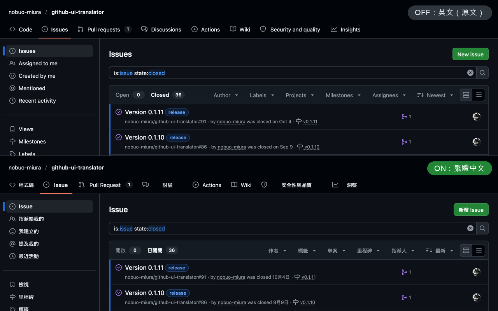
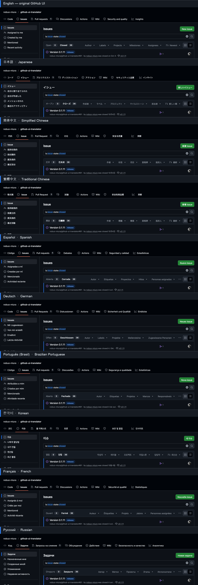
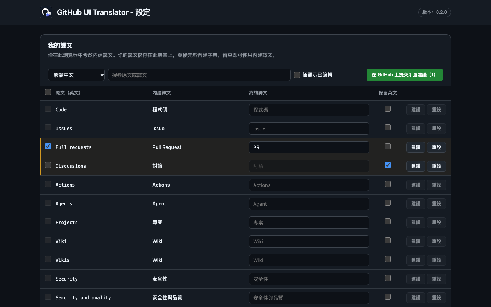

# GitHub UI Translator

[English](README.md) | [日本語](README.ja.md) | [简体中文](README.zh-CN.md) | [繁體中文](README.zh-TW.md) | [Español](README.es.md) | [Deutsch](README.de.md) | [Português (Brasil)](README.pt-BR.md) | [한국어](README.ko.md) | [Français](README.fr.md) | [Русский](README.ru.md)

[](https://github.com/nobuo-miura/github-ui-translator/releases/latest)
[](https://chromewebstore.google.com/detail/github-ui-translator/igdplojdbbpfbedgoaokfcagpkofmngk)
[](https://microsoftedge.microsoft.com/addons/detail/fgjocjmjjghflobobinafkbkeildanoj)
[](https://addons.mozilla.org/firefox/addon/github-ui-translator/)
[](https://github.com/nobuo-miura/github-ui-translator/actions/workflows/validate.yml)
[](./LICENSE)

GitHub UI Translator 是一款適用於 Chrome、Edge 和 Firefox 的瀏覽器擴充功能。它使用本機字典，將 GitHub 的英文介面翻譯成日語、簡體中文、繁體中文、西班牙語、德語、巴西葡萄牙語、韓語、法語或俄語。
本擴充功能不依賴外部翻譯 API 或雲端服務；所有翻譯均在瀏覽器內完成。



<details>
<summary>9 種語言的截圖</summary>

最上方是 GitHub 原始的英文介面，下方依序展示各語言的翻譯效果。



</details>

## 功能特點

- 所有翻譯均在本機完成，不會將頁面內容或設定傳送到外部服務
- 僅翻譯導覽項、按鈕等 GitHub 固定介面文字，並避開 README、Issue、留言和程式碼區塊等使用者建立的內容區域
- 可在擴充功能彈出視窗中一鍵開啟或關閉翻譯
- 等待 GitHub 的 React hydration 完成後再翻譯全域頁首，以降低影響全域搜尋的風險；也可以在彈出視窗中關閉此功能

## 文件

- [翻譯範圍（English）](docs/translation-scope.md)（[日本語](docs/translation-scope.ja.md)）

## 限制

- 目前支援日語、簡體中文、繁體中文、西班牙語、德語、巴西葡萄牙語、韓語、法語和俄語。隨著翻譯覆蓋範圍逐步完善，今後還會增加其他語言。
- 不翻譯包含數字或日期的動態文字，例如「3 commits」或「opened 2 days ago」。使用者名稱等使用者建立的內容也不在翻譯範圍內。詳情請參閱[翻譯範圍](docs/translation-scope.md)。
- 僅支援 `github.com`，不支援 GitHub Enterprise 或其他自訂域名。
- 已在 Chrome、Edge 和 Firefox 上完成測試。其他基於 Chromium 的瀏覽器可能也能正常使用，但尚未進行明確測試。

## 安裝

### Chrome

請從 [Chrome 線上應用程式商店](https://chromewebstore.google.com/detail/github-ui-translator/igdplojdbbpfbedgoaokfcagpkofmngk)安裝 GitHub UI Translator。

如果所在環境無法使用 Chrome 線上應用程式商店（例如由公司管理的裝置），可以手動安裝：

1. 從[最新版本](https://github.com/nobuo-miura/github-ui-translator/releases/latest)下載 `.zip` 檔案並解壓。
2. 在 Chrome 中開啟 `chrome://extensions`，然後啟用「開發者模式」。
3. 點選「載入未封裝項目」，並選擇解壓後的資料夾。

手動安裝的擴充功能不會自動更新。釋出新版本後，請重複上述步驟進行更新。組織策略也可能禁止開發者模式或手動安裝擴充功能；遇到這種情況時，請聯絡管理員。

### Edge

請從 [Microsoft Edge 附加元件](https://microsoftedge.microsoft.com/addons/detail/fgjocjmjjghflobobinafkbkeildanoj)安裝 GitHub UI Translator。

### Firefox

需要 Firefox 142 或更高版本。

請從 [Firefox 附加元件](https://addons.mozilla.org/firefox/addon/github-ui-translator/)安裝 GitHub UI Translator。

安裝後，開啟 `https://github.com/...` 等 GitHub 頁面，支援的介面文字便會自動翻譯成目前選擇的語言。

### 開發安裝（直接從儲存庫載入）

如果要自訂字典或參與開發，請複製儲存庫並直接載入擴充功能。

```sh
git clone https://github.com/nobuo-miura/github-ui-translator.git
```

- **Chrome / Edge**：在 Chrome 中開啟 `chrome://extensions`，或在 Edge 中開啟 `edge://extensions`，啟用開發者模式，點選「載入未封裝項目」，然後選擇包含 `manifest.json` 的複製目錄。
- **Firefox**：開啟 `about:debugging#/runtime/this-firefox`，點選「暫時載入附加元件…」，然後選擇儲存庫中的 `manifest.json`。暫時附加元件會在 Firefox 重啟後被移除，因此每次工作階段都需要重新載入。

## 使用方法

- 點選工具列中的擴充功能圖示，可以開啟翻譯開關和語言選擇器。目前內建日語、簡體中文、繁體中文、西班牙語、德語、巴西葡萄牙語、韓語、法語和俄語；新增字典後，下拉式清單也可繼續擴充。
- 在選擇語言之前，擴充功能會按瀏覽器的顯示語言進行翻譯；如果沒有對應的字典，則在你選擇語言之前不進行翻譯。在語言選擇器中選擇「自動」即可恢復此行為。
- 更改翻譯開關或語言後，已開啟的 GitHub 分頁會重新載入，以套用新設定。
- 彈出視窗還可設定是否翻譯全域頁首，並提供本儲存庫的連結。修改此選項也會重新載入已開啟的 GitHub 分頁。全域頁首翻譯預設開啟，並會等待 GitHub 的 React hydration 完成；如果全域搜尋無法開啟，可關閉此選項。
- 擴充功能更新前已開啟的 GitHub 分頁可能不會自動重新載入。如果設定沒有生效，請手動重新載入分頁。
- 在擴充功能選項頁面中，可以檢視內建字典資訊和擴充功能版本。Chrome 使用 `chrome://extensions`，Edge 使用 `edge://extensions`，Firefox 使用 `about:addons`。

### 我的譯文（使用者字典）



- 在 GitHub 上按住 Alt（Mac 上為 Option）並點擊已翻譯的文字，即可開啟編輯器。可以修改譯文、選擇「以英文顯示（不翻譯）」或還原為內建譯文。儲存後，目前分頁會重新載入；其他已開啟的 GitHub 分頁在重新載入後套用變更。可以在彈出視窗中關閉此功能。
- 選項頁面（也可透過彈出視窗中的「管理我的譯文」開啟）會列出所選語言的全部內建項目，可以搜尋、編輯、僅顯示已編輯項目以及重設。
- 我的譯文只能覆寫內建字典中已有的項目，不能新增項目。譯文僅儲存在此裝置上（`storage.local`）。如需備份或移轉到其他瀏覽器，請使用選項頁面的匯出／匯入功能。
- 選擇「在 GitHub 上提出建議」會開啟本儲存庫的翻譯請求表單，並預先填好你的建議（可逐筆提交，或一次提交最多 20 筆所選項目）。建議內容包含在頁面 URL 中，因此開啟表單時就會傳送到 GitHub。只有在你檢查並親自提交表單後，才會建立並公開 Issue。不需要權杖，也不會包含你正在瀏覽的頁面 URL。

## 自訂字典

直接編輯目標語言的字典檔案即可新增或修改翻譯，例如 `dictionaries/ja.json`、`dictionaries/zh-CN.json`、`dictionaries/zh-TW.json`、`dictionaries/es.json`、`dictionaries/de.json`、`dictionaries/pt-BR.json`、`dictionaries/ko.json`、`dictionaries/fr.json` 或 `dictionaries/ru.json`。
詞條按 GitHub 頁面分組（如儲存庫導覽、儲存庫設定和組織設定），每個分組前都有一行 `// ====` 註解，方便快速確認詞條所屬頁面，並及時發現 GitHub 介面文字的變化。

```jsonc
{
  "language": "ja",
  "name": "日本語",
  "translations": {
    // ==== リポジトリナビゲーション ====
    "Code": "コード",
    "Issues": "イシュー"
  }
}
```

- 字典檔案採用帶有 `//` 行註解的 JSON（類似 JSONC）。僅支援整行註解，不支援在值後新增行尾註解。標準的 `JSON.parse` 和 `fetch().json()` 無法解析註解，因此擴充功能會先移除註解行再解析檔案。
- 字典的鍵必須與原始英文文字**完全一致**。比對可見文字和支援的屬性值時，都會忽略首尾空白。僅對於可見文字，連續空白（包括換行）會摺疊為一個空格。比對 `aria-label`、`placeholder`、按鈕 `value` 和 `data-disable-with` 等屬性值時，會保留其內部空白。字典的鍵本身不得包含首尾空白。
- 編輯字典後，請重新載入擴充功能：Chrome 使用 `chrome://extensions`，Edge 使用 `edge://extensions`，Firefox 使用 `about:debugging`。

### 新增語言

1. 按照相同格式新增 `dictionaries/<code>.json`（例如 `dictionaries/en.json`）。
2. 將 `{ "code": "<code>", "name": "<display name>" }` 新增到 `languages.json`。彈出視窗和選項頁面都會讀取此共用清單。
3. 執行 `node scripts/validate.mjs`，檢查字典格式、重複鍵、中繼資料、內建字典之間的鍵一致性、自我對應、翻譯鏈以及不收斂的迴圈。

彈出視窗、選項頁面以及擴充功能中繼資料使用瀏覽器擴充功能的 `_locales` 機制，與 GitHub 翻譯字典相互獨立。如果還要為擴充功能自身的介面新增語言，請建立 `_locales/<code>/messages.json`，並確保其訊息鍵與 `_locales/en/messages.json` 一致。

## 專案結構

```text
github-ui-translator/
├─ manifest.json
├─ shared.js        # 共用語言清單和擴充功能介面在地化輔助函式
├─ languages.json   # 內建的 GitHub 翻譯語言
├─ content.js       # 使用允許清單掃描 DOM 的翻譯引擎
├─ popup.html/js    # 帶有翻譯開關的工具列彈出視窗
├─ options.html/js  # 字典資訊和版本顯示
├─ _locales/        # 在地化的彈出視窗、選項頁面和擴充功能中繼資料訊息
├─ dictionaries/
│  ├─ ja.json       # 日語字典
│  ├─ zh-CN.json    # 簡體中文字典
│  ├─ zh-TW.json    # 繁體中文字典
│  ├─ es.json       # 西班牙語字典
│  ├─ de.json       # 德語字典
│  ├─ pt-BR.json    # 巴西葡萄牙語字典
│  ├─ ko.json       # 韓語字典
│  ├─ fr.json       # 法語字典
│  └─ ru.json       # 俄語字典
├─ docs/
│  ├─ translation-scope.md     # 英文版
│  └─ translation-scope.ja.md  # 日文版
├─ scripts/
│  └─ validate.mjs  # 字典和在地化驗證
└─ icons/
```

## 參與貢獻

歡迎改進翻譯和報告問題。特別歡迎各語言的母語者幫助修改譯文，使其更加自然。

- 如需改進譯文或補充缺失的翻譯，請提交[翻譯請求](https://github.com/nobuo-miura/github-ui-translator/issues/new?template=translation_request.yml)，可以使用英文或中文填寫
- 在彈出視窗中開啟「滑鼠停留時顯示原文」後，將滑鼠停留在已翻譯的文字上即可看到英文原文（預設關閉），便於在翻譯請求中填寫原文
- 如需報告問題或提出功能建議，請提交 [Issue](https://github.com/nobuo-miura/github-ui-translator/issues/new/choose)
- 提交 Pull Request 之前，請先閱讀[貢獻指南](.github/CONTRIBUTING.zh-TW.md)

## 授權條款

[MIT 授權條款](./LICENSE)
